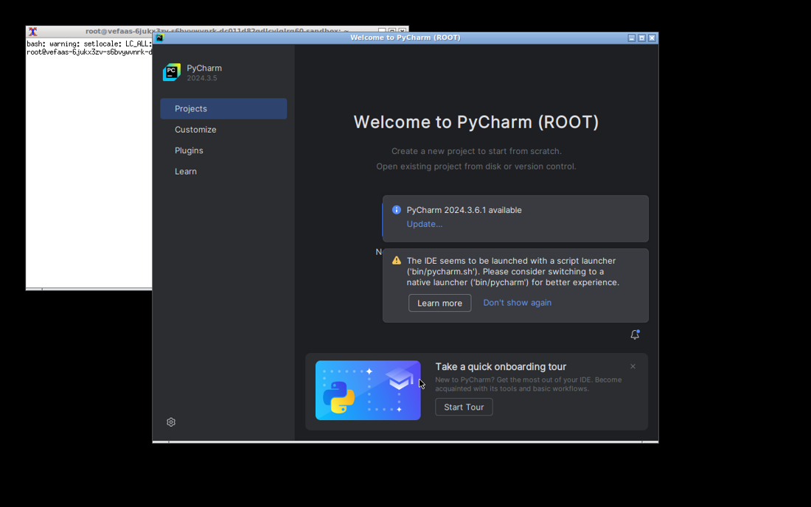

<div align="center">

# PyCharm for Android

**在 Android 手机上运行 JetBrains 官方 PyCharm 桌面版**

[](#)
[](#)
[](#)
[](#)

[介绍页](https://zhaohairuiour.github.io/PyCharm4Android/) · [下载最新版](https://ghfast.top/https://raw.githubusercontent.com/zhaohairuiour/PyCharm4Android/main/docs/apk/PyCharm4Android-1.9.7-arm64.apk) · [全部版本](#全部版本) · [构建](#构建)

</div>

---

## 这是什么

不是远程开发客户端，也不是重编译的“安卓版 PyCharm”。这个 APK 把三层运行时装进手机：

- **Linux 用户态**：Ubuntu 24.04 arm64 rootfs，Termux 版 proot 免 root 运行；
- **X 显示**：Xvfb 虚拟屏 + openbox 窗口管理 + x11vnc 固定 5901 端口；
- **渲染与输入**：自研原生 RFB 客户端直接写 `Bitmap`，单指移动/轻点/长按拖拽、双指缩放、双指右键、自绘软键盘注入 keysym。

IDE 本体是 JetBrains 官方 Linux arm64 发行版，安装时按需下载，不塞进 APK。社区版 2022.3–2025.3、专业版 2022.3–2026.3.0.1 可选。



## v1.9.7 更新：科技感安装界面

- 深空渐变 + 青色坐标网格背景，纯 Canvas 绘制（`TechBackgroundView`）；
- 状态卡、日志面板、胶囊按钮全部圆角，带描边与按压反馈；
- 状态文字按运行/就绪/错误变色，禁用按钮自动降透明度；
- 版本号、设备内存、架构、镜像源、已装 IDE 以 monospace 信息面板呈现。

## 特性

| | |
|---|---|
| **官方 IDE** | 直接运行 JetBrains 官方 Linux arm64 构建，不是兼容层或重编译 |
| **免 root** | proot + 自编译 loader，零售机、未解锁 Bootloader 可用 |
| **原生 RFB** | 仅 Raw + CopyRect，不走 noVNC / WebView，无 JS 解码 |
| **固定端口** | 服务端与客户端都写死 5901，不做端口扫描 |
| **窗口外观** | Breeze-PyCharm 深色 openbox 主题，30 px 按钮、红色关闭、Alt+F9/F10 |
| **版本管理** | 社区版/专业版双目录、断点续传、SHA-256 + 体积双校验、卸载与缓存清理 |
| **脚本自刷新** | 每次启动用 APK assets 覆盖容器内 `run-ide.sh`/`extract-ide.sh`/`setup.sh` |
| **崩溃可诊断** | `files/crash.txt` 下次启动自动回显；日志面板增量刷新、贴底才跟随 |

## 架构

```text
APK
├─ assets/proot/            proot + libtalloc + libandroid-shmem + loader
├─ assets/scripts/          setup.sh / run-ide.sh / extract-ide.sh
├─ assets/scripts/openbox-theme.tar + openbox-rc.xml
└─ Java
   ├─ SetupService           rootfs / PyCharm 下载、校验、解包、apt 安装
   ├─ IdeService             前台服务：常驻容器，IDE 退出后自动重启
   ├─ Proot / Rootfs         proot 命令组装、loader 覆盖、挂载点
   ├─ Downloader / Versions  多镜像、Range 续传、社区版/专业版版本目录
   ├─ TarGz                  纯 Java tar.gz 解包（保留权限/符号链接/硬链接）
   ├─ VncClient              原生 RFB：握手、Raw/CopyRect、单线程发送队列
   └─ VncView                Bitmap 绘制、触摸状态机、内置箭头光标
```

运行链路：`proot Ubuntu → Xvfb :1 → x11vnc :5901 → RFB → Canvas`。

## 全部版本

| 版本 | 日期 | 体积 | SHA-256 | APK |
|---|---|---|---|---|
| v1.9.7 | 2026-11-21 | 276 KB | [`3462e049f328…`] | [下载](https://ghfast.top/https://raw.githubusercontent.com/zhaohairuiour/PyCharm4Android/main/docs/apk/PyCharm4Android-1.9.7-arm64.apk) |
| v1.9.6 | 2026-11-21 | 270 KB | [`6d0f28581a09…`] | [下载](https://ghfast.top/https://raw.githubusercontent.com/zhaohairuiour/PyCharm4Android/main/docs/apk/PyCharm4Android-1.9.6-arm64.apk) |
| v1.9.5 | 2026-11-21 | 262 KB | [`582d5806ca72…`] | [下载](https://ghfast.top/https://raw.githubusercontent.com/zhaohairuiour/PyCharm4Android/main/docs/apk/PyCharm4Android-1.9.5-arm64.apk) |
| v1.9.4 | 2026-11-21 | 262 KB | [`6e3240e04f8d…`] | [下载](https://ghfast.top/https://raw.githubusercontent.com/zhaohairuiour/PyCharm4Android/main/docs/apk/PyCharm4Android-1.9.4-arm64.apk) |
| v1.9.3 | 2026-11-21 | 261 KB | [`c4b3636208c7…`] | [下载](https://ghfast.top/https://raw.githubusercontent.com/zhaohairuiour/PyCharm4Android/main/docs/apk/PyCharm4Android-1.9.3-arm64.apk) |
| v1.9.2 | 2026-11-21 | 261 KB | [`ad7f85cd7cca…`] | [下载](https://ghfast.top/https://raw.githubusercontent.com/zhaohairuiour/PyCharm4Android/main/docs/apk/PyCharm4Android-1.9.2-arm64.apk) |
| v1.9.1 | 2026-11-21 | 257 KB | [`a1ae26ffad6b…`] | [下载](https://ghfast.top/https://raw.githubusercontent.com/zhaohairuiour/PyCharm4Android/main/docs/apk/PyCharm4Android-1.9.1-arm64.apk) |
| v1.9.0 | 2026-11-21 | 257 KB | [`7264747e5834…`] | [下载](https://ghfast.top/https://raw.githubusercontent.com/zhaohairuiour/PyCharm4Android/main/docs/apk/PyCharm4Android-1.9.0-arm64.apk) |
| v1.8.3 | 2026-11-21 | 257 KB | [`4b4859ace03d…`] | [下载](https://ghfast.top/https://raw.githubusercontent.com/zhaohairuiour/PyCharm4Android/main/docs/apk/PyCharm4Android-1.8.3-arm64.apk) |
| v1.8.2 | 2026-11-21 | 257 KB | [`fa1f55fcac1b…`] | [下载](https://ghfast.top/https://raw.githubusercontent.com/zhaohairuiour/PyCharm4Android/main/docs/apk/PyCharm4Android-1.8.2-arm64.apk) |
| v1.8.1 | 2026-11-21 | 257 KB | [`512b0564993d…`] | [下载](https://ghfast.top/https://raw.githubusercontent.com/zhaohairuiour/PyCharm4Android/main/docs/apk/PyCharm4Android-1.8.1-arm64.apk) |
| v1.8.0 | 2026-11-21 | 257 KB | [`037324d95bd4…`] | [下载](https://ghfast.top/https://raw.githubusercontent.com/zhaohairuiour/PyCharm4Android/main/docs/apk/PyCharm4Android-1.8.0-arm64.apk) |
| v1.7.2 | 2026-11-21 | 257 KB | [`f1e51d848634…`] | [下载](https://ghfast.top/https://raw.githubusercontent.com/zhaohairuiour/PyCharm4Android/main/docs/apk/PyCharm4Android-1.7.2-arm64.apk) |
| v1.7.1 | 2026-11-21 | 257 KB | [`0b84b8b6d912…`] | [下载](https://ghfast.top/https://raw.githubusercontent.com/zhaohairuiour/PyCharm4Android/main/docs/apk/PyCharm4Android-1.7.1-arm64.apk) |
| v1.7.0 | 2026-11-21 | 257 KB | [`abd6185b6650…`] | [下载](https://ghfast.top/https://raw.githubusercontent.com/zhaohairuiour/PyCharm4Android/main/docs/apk/PyCharm4Android-1.7.0-arm64.apk) |
| v1.6.1 | 2026-11-21 | 244 KB | [`c2785aa82085…`] | [下载](https://ghfast.top/https://raw.githubusercontent.com/zhaohairuiour/PyCharm4Android/main/docs/apk/PyCharm4Android-1.6.1-arm64.apk) |
| v1.6.0 | 2026-11-21 | 244 KB | [`0ecd197f0747…`] | [下载](https://ghfast.top/https://raw.githubusercontent.com/zhaohairuiour/PyCharm4Android/main/docs/apk/PyCharm4Android-1.6.0-arm64.apk) |
| v1.5.0 | 2026-11-21 | 244 KB | [`de6a541cfa22…`] | [下载](https://ghfast.top/https://raw.githubusercontent.com/zhaohairuiour/PyCharm4Android/main/docs/apk/PyCharm4Android-1.5.0-arm64.apk) |
| v1.4.0 | 2026-11-21 | 199 KB | [`cd2903d678d6…`] | [下载](https://ghfast.top/https://raw.githubusercontent.com/zhaohairuiour/PyCharm4Android/main/docs/apk/PyCharm4Android-1.4.0-arm64.apk) |
| v1.3.0 | 2026-11-21 | 199 KB | [`503fe375a871…`] | [下载](https://ghfast.top/https://raw.githubusercontent.com/zhaohairuiour/PyCharm4Android/main/docs/apk/PyCharm4Android-1.3.0-arm64.apk) |
| v1.2.0 | 2026-11-20 | 199 KB | [`75c8ec792c16…`] | [下载](https://ghfast.top/https://raw.githubusercontent.com/zhaohairuiour/PyCharm4Android/main/docs/apk/PyCharm4Android-1.2.0-arm64.apk) |
| v1.1.1 | 2026-11-20 | 191 KB | [`6654047c1424…`] | [下载](https://ghfast.top/https://raw.githubusercontent.com/zhaohairuiour/PyCharm4Android/main/docs/apk/PyCharm4Android-1.1.1-arm64.apk) |
| v1.1.0 | 2026-11-20 | 191 KB | [`15bf4da9f3df…`] | [下载](https://ghfast.top/https://raw.githubusercontent.com/zhaohairuiour/PyCharm4Android/main/docs/apk/PyCharm4Android-1.1.0-arm64.apk) |
| v1.0.0 | 2026-11-20 | 187 KB | [`931c3830bb20…`] | [下载](https://ghfast.top/https://raw.githubusercontent.com/zhaohairuiour/PyCharm4Android/main/docs/apk/PyCharm4Android-1.0.0-arm64.apk) |

所有 APK 也放在 [`docs/apk/`](docs/apk/)，GitHub Pages 直接提供下载。覆盖安装保留容器与已下载的 IDE。

> 国内下载建议使用镜像源：[ghfast 加速](https://ghfast.top/https://raw.githubusercontent.com/zhaohairuiour/PyCharm4Android/main/docs/apk/PyCharm4Android-1.9.7-arm64.apk) · [ghproxy 备用](https://ghproxy.net/https://raw.githubusercontent.com/zhaohairuiour/PyCharm4Android/main/docs/apk/PyCharm4Android-1.9.7-arm64.apk)。介绍页的下载按钮默认走镜像，也可切换 GitHub 直链；全版本文件与 SHA-256 均一致。

## 安装

1. 下载 `PyCharm4Android-1.9.7-arm64.apk`，允许“安装未知应用”；
2. 打开应用点「开始安装」：自动下载 Ubuntu base（约 30 MB）、校验 SHA-256、解包、apt 安装 X11/VNC，再下载 PyCharm（750 MB–1.3 GB）；
3. 点「启动 PyCharm」进入桌面。首次 JVM 冷启动 1–3 分钟，之后固定连接 `127.0.0.1:5901`。

要求：arm64 设备、Android 8.0+、建议 7 GB 内存、8 GB 以上空闲存储。

## 构建

需要 JDK 17、Android SDK 34、Gradle 8.7：

```bash
export JAVA_HOME=/path/to/jdk17
export ANDROID_HOME=/path/to/android-sdk
gradle assembleRelease --no-daemon
# 产物 app/build/outputs/apk/release/app-release.apk
```

`local.properties` 写入 `sdk.dir=/path/to/android-sdk`。当前使用 debug key 签名，覆盖安装可保留数据。

## 项目结构

- `app/src/main/java/com/pycharm4android/` — Android 端全部 Java 代码
- `app/src/main/assets/scripts/` — 容器内启动/解包/apt 脚本与 openbox 主题
- `docs/` — GitHub Pages 介绍页与全部历史 APK
- `PROJECT_LOG.md` — 逐版本开发日志与踩坑记录

## 已知限制

- 仅 arm64；x86 设备不适用。
- proot 的 ptrace 开销在启动/大量文件 IO 时明显，稳定后影响有限。
- 专业版需要 JetBrains 账号激活（含 30 天试用）。
- 首次安装依赖网络，国内建议使用阿里云/华为云镜像（应用内可切换）。

## 声明

本项目为非官方封装，与 JetBrains s.r.o. 无隶属关系。PyCharm 是 JetBrains s.r.o. 的商标；APK 不包含 IDE 本体，安装时从 JetBrains 官方 CDN 下载。

## License

[MIT](LICENSE)
